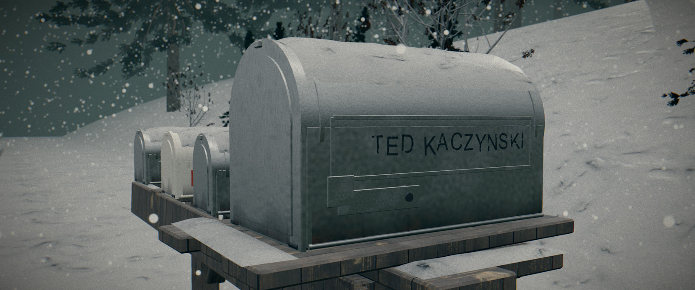

# Model Evidence — Portfolio

3D artist & technical artist portfolio: models, environments, sets and textures — and the custom pipeline that turns them into finished documentary films.

**Live site:** https://amitkmarreji.github.io/Model-evidence/
**Channel:** https://www.youtube.com/@ModelEvidence

## What this is

I make true-crime and history documentaries solo — every episode is rebuilt in 3D from primary sources, then lit, posed, rendered, scored and delivered end-to-end. This repository is the portfolio site for that work, plus a summary of the tooling behind it.

Three episodes shipped on YouTube (Alcatraz escape · the Mona Lisa heist · the $500M Gardner-style art heist). Episode IV is in production — all frames in the gallery are from its current build.

## Tooling (built for my own studio, in daily production)

| Tool | What it does | Stack |
|---|---|---|
| **Real-time render engine + farm** | Custom-built real-time engine with a hand-tuned post chain (N8AO, thin-lens DOF, mip bloom, AgX, SMAA, halation, film LUT), supersampled rendering, GPU job server, hardware H.264 encode | WebGL · Node · ffmpeg |
| **pose-three** | Browser posing studio: pose characters inside the real set through the shot camera; IK grips, finger presets, drag-to-place with ground marks, safe-save UX | TypeScript · Vite · IK |
| **Quality audits** | Automated per-frame checks: reach-miss, ghost/penetration, camera comfort governors (°/s), candela light budgets | CG QA · automation |
| **Procedural set builders** | Headless Blender scripts turning floor plans + archive photos into dressed, textured sets (cabin, motel, newsroom, mailbox) | Blender bpy · Python |
| **Assembly pipeline** | Resolve edit + grade, scored and ducked mixes at −14 LUFS, 2.39:1 delivery | DaVinci Resolve · ffmpeg |

## Skills

Blender (modelling, procedural sets, texturing/decals) · Unreal Engine · Unity · WebGL · Python & JS tooling · DaVinci Resolve · motion graphics · AI-assisted production workflows (narration, scoring, research) under manual art direction.

## Site

Static single-page site — `index.html` + `assets/img/`. No build step. Served by GitHub Pages.

## Contact

YouTube — [@ModelEvidence](https://www.youtube.com/@ModelEvidence) · GitHub — [Amitkmarreji](https://github.com/Amitkmarreji)
